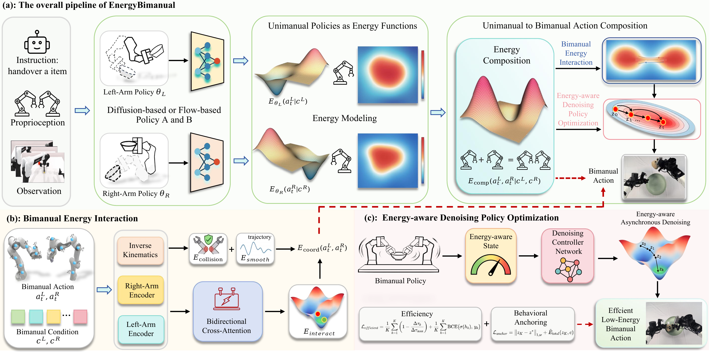

<div align="center">

# EnergyBimanual: A Unified Energy Framework for Unimanual-to-Bimanual Policy Composition

<div>
<a href="https://ieeexplore.ieee.org/author/37087008154">Weili&nbsp;Guan</a><sup>1 3</sup>,
Mingchen&nbsp;Song<sup>1 2</sup>,
<a href="https://homepage.hit.edu.cn/dengxiang">Xiang&nbsp;Deng</a><sup>1 3</sup>,
Jie&nbsp;Wei<sup>1</sup>,
<a href="https://scholar.google.com/citations?hl=en&amp;user=Awsue7sAAAAJ">Dongmei&nbsp;Jiang</a><sup>2</sup>,
<a href="https://scholar.google.com/citations?hl=en&amp;user=yywVMhUAAAAJ">Liqiang&nbsp;Nie</a><sup>1</sup>
</div>
<sup>1</sup>Harbin Institute of Technology (Shenzhen)&nbsp;&nbsp;
<sup>2</sup>Peng Cheng Laboratory&nbsp;&nbsp;
<sup>3</sup>Shenzhen Loop Area Institute
<br><br>
<a href="#manuscript-citation"></a>
<a href="https://huggingface.co/mingchens/EnergyBimanual"></a>

</div>

## 📖 Introduction

During a handover, the receiving gripper must secure the object before the other lets go. When lifting a tray, both arms must support it throughout the lift. **EnergyBimanual** reuses pretrained single-arm policies and learns these different forms of coordination from a small set of bimanual demonstrations.

[](docs/images/energybimanual-framework.png)

In **panel (a)**, each arm’s policy evaluates a proposed motion at sampled noise levels. A motion that better matches the policy’s predictions receives a lower energy. Adding the left and right energies gives a common score even when one arm uses a diffusion policy and the other uses flow matching.

**Bimanual Energy Interaction**, shown in **panel (b)**, adds a coordination term to that score. Each arm’s encoder takes its proposed action, its state, the visual observation, and the language instruction. Bidirectional cross-attention lets each arm account for the other’s motion. Smoothness and collision penalties discourage abrupt movements and collisions between the arms.

**Panel (c)** shows how the paper uses the joint energy to guide denoising. A lightweight controller reads the current energy and its change since the previous step, adjusts the step size, and decides when to stop. The underlying policy stays fixed and supplies the direction for each update.

This repository provides evaluation code and checkpoints for 13 bimanual RLBench tasks and six RoboTwin 2.0 tasks, with 5, 10, or 20 bimanual demonstrations per task.

## ⚙️ Environment Setup

Run the commands from the EnergyBimanual repository root on a Linux machine with an NVIDIA GPU. RLBench uses CoppeliaSim for physics and OpenGL rendering. RoboTwin 2.0 uses SAPIEN and a Vulkan renderer. Select the Python environment for the benchmark you want to run.

### Bimanual RLBench

Create a Python 3.10 environment for the bimanual RLBench simulator and policy. Unpack CoppeliaSim 4.1, set `COPPELIASIM_ROOT` to the directory containing its executable, and make its shared libraries and Qt plugins visible to PyRep.

```bash
conda create -n energybimanual-rlbench python=3.10 -y
conda activate energybimanual-rlbench

export COPPELIASIM_ROOT=/path/to/CoppeliaSim_Edu_V4_1_0
export LD_LIBRARY_PATH="$COPPELIASIM_ROOT${LD_LIBRARY_PATH:+:$LD_LIBRARY_PATH}"
export QT_QPA_PLATFORM_PLUGIN_PATH="$COPPELIASIM_ROOT"

python -m pip install torch==2.2.0 torchvision==0.17.0 --index-url https://download.pytorch.org/whl/cu121
python -m pip install -r requirements/rlbench.txt
```

Install the PerAct² forks of PyRep and RLBench in this environment using the upstream editable-install instructions. The evaluator imports their bimanual arm and gripper action modes. On a headless server, configure an X display with OpenGL support so CoppeliaSim can render the camera observations. [PerAct² installation](https://github.com/markusgrotz/peract_bimanual/blob/main/INSTALLATION.md) · [RLBench revision](https://github.com/markusgrotz/RLBench/tree/8af748c51287989294e00c9c670e3330a0e35ed5)

Download the **256 × 256 test split** for the tasks you want to evaluate. Point `PERACT2_DATA_ROOT` at the directory immediately above the task folders. For Push Box, check that the first saved episode and the bimanual action mode are accessible. [PerAct² test data](https://bimanual.github.io/)

```bash
export PERACT2_DATA_ROOT=/path/to/peract2/test
test -f "$PERACT2_DATA_ROOT/bimanual_push_box/variation0/episodes/episode0/low_dim_obs.pkl"
python -c "from rlbench.action_modes.action_mode import BimanualMoveArmThenGripper"
```

### RoboTwin 2.0

All RoboTwin 2.0 evaluations in the paper used the `openpi/.venv` environment with the following versions.

| Python | PyTorch | JAX | jaxlib | Orbax Checkpoint | NVIDIA driver |
| --- | --- | --- | --- | --- | --- |
| 3.11 | 2.7.1 | 0.5.3 | 0.5.3 | 0.11.13 | 550 |

For a fresh environment, create it with `python3.11 -m venv /path/to/openpi/.venv`. Activate it and install the policy dependencies. The requirements select the CUDA 12 build of JAX. Use the matching CUDA build of torchvision 0.22.1 with PyTorch 2.7.1. [PyTorch installation options](https://pytorch.org/get-started/previous-versions/)

```bash
source /path/to/openpi/.venv/bin/activate
export ROBOTWIN_ROOT=/path/to/RoboTwin
python -m pip install torchvision==0.22.1 jaxlib==0.5.3 \
  -r requirements/diffusion.txt -r requirements/openpi.txt
```

Install SAPIEN 3.0.0b1, MPLib 0.2.1 and cuRobo in the same interpreter. For the Franka camera pipeline, install a PyTorch3D build compatible with the installed PyTorch and CUDA versions. Download the RoboTwin object models, textures and robot embodiments into the external RoboTwin checkout. The evaluator reads these assets from `ROBOTWIN_ROOT`. [RoboTwin simulator installation and asset download](https://robotwin-platform.github.io/doc/usage/robotwin-install.html)

```bash
(cd "$ROBOTWIN_ROOT" && bash scripts/_download_assets.sh)
```

| Policy | Robot asset under `ROBOTWIN_ROOT/assets/embodiments/` | Policy inputs |
| --- | --- | --- |
| DP + DP | `franka-panda/` | Head and wrist RGB images and arm joint positions |
| DP3 + DP3 | `franka-panda/` | A 1,024-point cloud and arm joint positions |
| π₀ + π₀ and π₀.₅ + π₀.₅ | `aloha-agilex/` | Head and wrist RGB images, joint positions and a language instruction |

Check that Vulkan lists the NVIDIA GPU and that the selected robot has its `config.yml`. The example below checks Franka. For ALOHA, use `aloha-agilex` as the embodiment.

```bash
vulkaninfo --summary
embodiment=franka-panda
test -d "$ROBOTWIN_ROOT/assets/objects"
test -f "$ROBOTWIN_ROOT/assets/embodiments/$embodiment/config.yml"
```

## 📦 Checkpoints

Weights are organized by benchmark, policy and demonstration count. Each link below opens a published checkpoint. [Hugging Face model repository](https://huggingface.co/mingchens/EnergyBimanual) · [Download instructions](docs/distribution.md)

### Bimanual RLBench

| Demos per task | EnergyBimanual |
| ---: | --- |
| 5 | [energybimanual_5demo.pth](https://huggingface.co/mingchens/EnergyBimanual/resolve/main/checkpoints/RLBench/energybimanual_5demo.pth) |
| 10 | [energybimanual_10demo.pth](https://huggingface.co/mingchens/EnergyBimanual/resolve/main/checkpoints/RLBench/energybimanual_10demo.pth) |
| 20 | [energybimanual_20demo.pth](https://huggingface.co/mingchens/EnergyBimanual/resolve/main/checkpoints/RLBench/energybimanual_20demo.pth) |

### RoboTwin 2.0

| Demos per task | DP + DP | DP3 + DP3 | π₀ + π₀ | π₀.₅ + π₀.₅ |
| ---: | --- | --- | --- | --- |
| 5 | [dp_5demo.pt](https://huggingface.co/mingchens/EnergyBimanual/resolve/main/checkpoints/RoboTwin2.0/dp_5demo.pt) | [dp3_5demo.pt](https://huggingface.co/mingchens/EnergyBimanual/resolve/main/checkpoints/RoboTwin2.0/dp3_5demo.pt) | `pi0_5demo` | `pi0.5_5demo` |
| 10 | [dp_10demo.pt](https://huggingface.co/mingchens/EnergyBimanual/resolve/main/checkpoints/RoboTwin2.0/dp_10demo.pt) | [dp3_10demo.pt](https://huggingface.co/mingchens/EnergyBimanual/resolve/main/checkpoints/RoboTwin2.0/dp3_10demo.pt) | `pi0_10demo` | `pi0.5_10demo` |
| 20 | [dp_20demo.pt](https://huggingface.co/mingchens/EnergyBimanual/resolve/main/checkpoints/RoboTwin2.0/dp_20demo.pt) | [dp3_20demo.pt](https://huggingface.co/mingchens/EnergyBimanual/resolve/main/checkpoints/RoboTwin2.0/dp3_20demo.pt) | `pi0_20demo` | `pi0.5_20demo` |

DP and DP3 use Franka. The π policies use ALOHA. Download the full π checkpoint directory to keep its parameter shards and normalization statistics together.

## 🧪 Evaluation

```bash
CUDA_VISIBLE_DEVICES=0 python evaluate.py rlbench \
  --method energybimanual --demos 5 --task bimanual_push_box --seed 0

CUDA_VISIBLE_DEVICES=0 python evaluate.py robotwin \
  --method dp3 --demos 5 --task grab_roller --seed 0

CUDA_VISIBLE_DEVICES=1 python evaluate.py robotwin \
  --method pi0 --demos 5 --task place_burger_fries --seed 0
```

Use `--task all` for the full task list and `--demos` with 5, 10 or 20 to select the checkpoint. The optional ALOHA patch skips a missing planner target during the expert check and records skipped scene seeds.

```bash
git apply --check patches/aloha-expert-seeds.patch
git apply patches/aloha-expert-seeds.patch
```

## 🗂️ Project Structure

```text
evaluate.py                  Evaluation entry point
rlbench2/                    RLBench policies and evaluator
robotwin/                    RoboTwin policies, tasks and evaluator
requirements/                Policy dependencies
patches/                     Optional ALOHA expert patch
checkpoints/                 Model weights (separate download)
CHECKSUMS.sha256             Checkpoint checksums
licenses/                    Third-party licenses
```

## 🙏 Acknowledgement

We thank the PerAct² and RoboTwin teams for their simulators, tasks and evaluation assets. The policy implementations build on the work of the 3D FlowMatch Actor, Diffusion Policy, 3D Diffusion Policy and OpenPI authors. [PerAct²](https://bimanual.github.io/) · [RoboTwin](https://github.com/RoboTwin-Platform/RoboTwin) · [3D FlowMatch Actor](https://github.com/nickgkan/3d_flowmatch_actor) · [Diffusion Policy](https://github.com/real-stanford/diffusion_policy) · [3D Diffusion Policy](https://github.com/YanjieZe/3D-Diffusion-Policy) · [OpenPI](https://github.com/Physical-Intelligence/openpi)

<a name="manuscript-citation"></a>

## 📚 Citation

```bibtex
@misc{guan2026energybimanual,
  title  = {{EnergyBimanual}: A Unified Energy Framework for Unimanual-to-Bimanual Policy Composition},
  author = {Guan, Weili and Song, Mingchen and Deng, Xiang and Wei, Jie and Jiang, Dongmei and Nie, Liqiang},
  year   = {2026},
  note   = {Manuscript}
}
```
